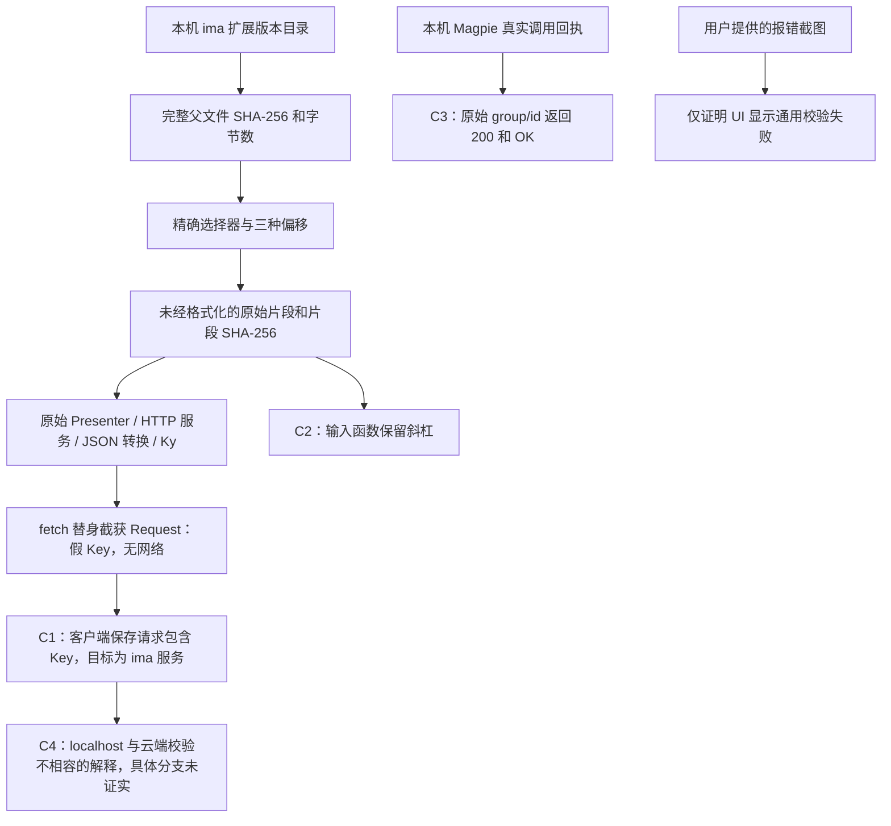

# 证据链

## 来源 → 片段 → 执行 → 结论

真实保存请求的网络捕获尚未取得；不能把 F 标记为网络抓包。当前闭合的是客户端实现及隔离运行的证据链，服务器内部存储和调用链不在其证明范围内。

## 1. 固定父文件

[source-manifest.json](../evidence/source-manifest.json) 为 6 个完整原文件记录来源相对路径、版本目录、字节数和 SHA-256。原文件读取时间以 manifest 的 `observed_at_utc` 为准；该字段不是厂商发布日期。

扩展目录固定到具体版本。最初定位时还发现缓存中的 `settings_100.crx` 声明版本为 `5.3.8`，而本次主证据采用已安装的 `5.11.1`，没有把旧缓存当作当前设置页。

主程序签名核验有独立回执。其结果只说明 host application 的签名检查通过，不替代 profile 脚本的来源认证。第一次沙箱内检查无法取得完整签名信息，沙箱外核验通过；公开签名回执记录沙箱外结果。

## 2. 固定片段与位置

每个片段记录：父文件身份、精确开始/结束选择器、SHA-256、字节数，以及零基、右端不包含的三种坐标：

- `code_point_start/end`：UTF-8 解码后的 Unicode 码点偏移。
- `utf16_start/end`：JavaScript 字符串使用的 UTF-16 码元偏移。
- `utf8_byte_start/end`：原文件的 UTF-8 字节偏移。

三个坐标明确区分，避免在中文或非 BMP 字符前后错位。片段保持原始字节，不附加注释或结尾换行；说明放在 manifest。

## 3. 重建与执行

`scripts/extract_sources.py` 验证完整原文件身份，再重建全部公开片段；若任何哈希或偏移不同就失败。

`scripts/reproduce.cjs` 先验证所加载片段哈希，再执行选定原始函数。它没有执行整个应用的 bootstrap。Request 由原始 Ky 代码构造，`globalThis.fetch` 替身只读取这个 Request 并给出合成错误回复，没有把它发送到外网。

[offline-reproduction.json](../evidence/observations/offline-reproduction.json) 记录了目标 URL、POST body、输入测试、全部替身和 8 项检查。复现结果与该回执作精确 JSON 对比。`original-local-probe.json` 是仓库整理前那次本地隔离实验的原回执；两个实验都不是网络抓包。

## 4. 独立观察

- [Magpie 回执](../evidence/observations/magpie-direct-probe.json)：一次真实本机请求，带 `/` 的原始模型 ID，HTTP 200，回复 `OK`。生成 2 个 completion token；上游报告的 prompt token 数包含其系统上下文，不能按诊断文本长度推算费用。
- [用户截图](../evidence/screenshots/user-supplied-save-error.png)：完整 localhost 接口路径、原始模型 ID、掩码 Key、通用错误。截图来源及哈希见 [attachments.json](../evidence/attachments.json)。没有独立时间戳或设备签名。
- [官方隐私指引](https://privacy.qq.com/document/preview/aca5ed13893d47cfa31697704c2dd366)：核读页面显示更新与生效日期为 2026-10-23；第 1.2（1）项说明 AI 内容上云。政策文字不是服务器实现审计。
- [真实网络捕获状态](network-capture.md)：尚未取得，另列为待补观察。

## 5. 可验证程度

有同版完整原文件的读者可以闭合父文件身份、精确片段和运行结果这条链。没有原文件的读者可以验证公开内容未变、片段之间的调用关系和隔离运行结果，但无法仅凭仓库证明本机安装来源或厂商签名。仓库哈希也不能独立证明观察时间。

尚未闭合的链路：实际已认证保存请求 → 腾讯服务端具体校验分支 → 服务端保存/删除 Key → 服务端向模型供应商发出的请求。相应结论保留为未知或推断。
